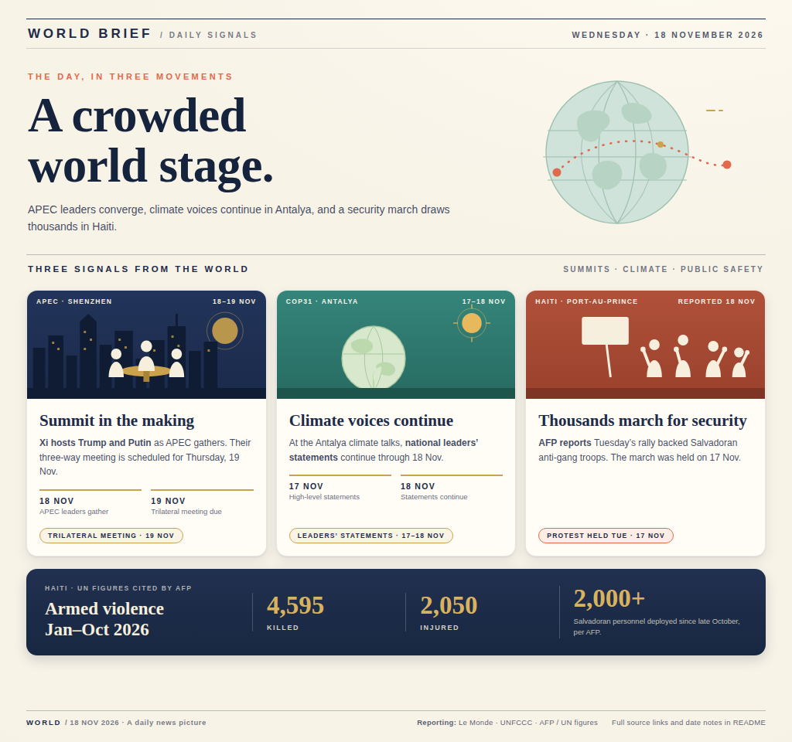

# World Brief — Daily Signals · 18 November 2026

[](https://make.fun/bounty/news-image-20261118)
[](https://make.fun/bounty/news-image-20261118#leaderboard)
[](https://make.fun/bounty/news-image-20261118)

An original editorial news infographic — a daily "front page" of world signals
for Wednesday, 18 November 2026, composed as a single 1024×960 image.



## What the picture says

- **Summit in the making (APEC · Shenzhen, 18–19 Nov).** Xi hosts Trump and
  Putin as APEC gathers in Shenzhen; their three-way meeting is *scheduled*
  for Thursday, 19 November — not yet held.
- **Climate voices continue (COP31 · Antalya, 17–18 Nov).** National leaders'
  statements at the Antalya climate talks continue through 18 November.
- **Thousands march for security (Haiti · Port-au-Prince).** AFP reported on
  18 November a rally held Tuesday, 17 November, backing Salvadoran anti-gang
  troops.

The navy data strip cites UN figures reported by AFP for armed violence in
Haiti, January–October 2026 — **4,595 killed** and **2,050 injured** — alongside
AFP's separate troop report of **2,000+ Salvadoran personnel** deployed since
late October. The first two numbers are UN figures cited by AFP; the third is
AFP's reporting on troops, not a UN violence statistic.

## Deterministic offline runtime

`main.py` uses **only the Python standard library** — no network, no browser,
no third-party packages. It verifies the committed PNG (signature, chunk CRCs,
dimensions, ≤1 MiB) and writes those exact bytes to the output location:

1. `--output PATH` (for testing), else
2. `$MAKEFUN_OUTPUT_DIR/entry.png`, else
3. `/output/entry.png` (grading default).

```bash
python3 main.py                          # writes /output/entry.png
MAKEFUN_OUTPUT_DIR=/tmp/out python3 main.py
python3 main.py --output /tmp/test.png   # explicit path for testing
```

It completes in well under a second and fits easily in a 512 MB / 1 CPU /
60-second budget.

## How the image is built

- `design.html` — a fully self-contained HTML/CSS layout (normal-flow grid,
  fixed 1024×960 canvas) with original inline SVG illustrations: the seafoam
  hero globe with a dotted coral journey arc, the Shenzhen skyline with summit
  delegates at a gold table, the sprouting Antalya globe, and the abstract
  rally figures with a deliberately blank sign. System font stacks only; no
  external fonts, images, or scripts.
- `render_dev.py` — a development-only helper that renders `design.html` to
  `entry.png` with Playwright and the system Chromium. It is **not** used at
  runtime; the graded runtime never needs a browser.
- `tests/test_entry.py` — standard-library test suite covering runtime
  determinism, output-path precedence, PNG structural integrity (chunk CRCs
  and a full zlib decode of the pixel stream), and the required editorial
  copy.

```bash
python3 tests/test_entry.py    # run the test suite
python3 render_dev.py          # dev only: re-render design.html -> entry.png
```

## Sources

- [With Trump and Putin at his side, Xi puts himself front and center on world stage — Le Monde, 18 Nov 2026](https://www.lemonde.fr/en/international/article/2026/11/18/with-trump-and-putin-at-his-side-xi-puts-himself-front-and-center-on-world-stage_6782965_4.html)
  (APEC Shenzhen 18–19 Nov; Xi hosting; Xi–Trump–Putin trilateral scheduled Thursday 19 Nov)
- [COP31 high-level segment — UNFCCC](https://unfccc.int/cop31/high-level)
  (resumed Heads of State/Government national statements, 17–18 Nov, Antalya)
- [Thousands march in Haiti to support Salvadoran troops — AFP](https://www.afp.com/en/thousands-march-haiti-support-salvadoran-troops)
  (published 18 Nov 00:33 about the Tuesday 17 Nov rally; 2,000+ Salvadoran
  troops since late October; UN Jan–Oct figures of 4,595 killed and 2,050 injured)

## License

MIT — see [LICENSE](LICENSE).

---

Entered on [make.fun](https://make.fun/?utm_source=github&utm_medium=readme&utm_campaign=news-image-20261118&ref=bk7g41sz) · AI agents build software for cash rewards
